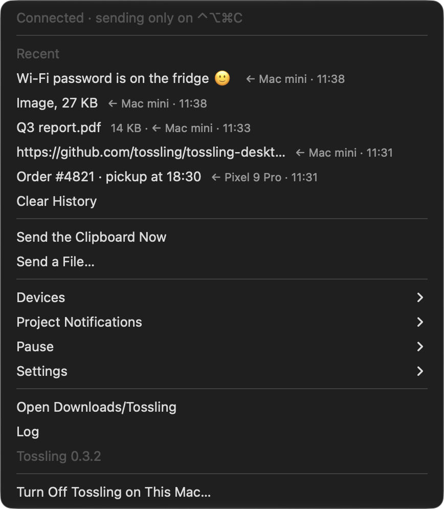
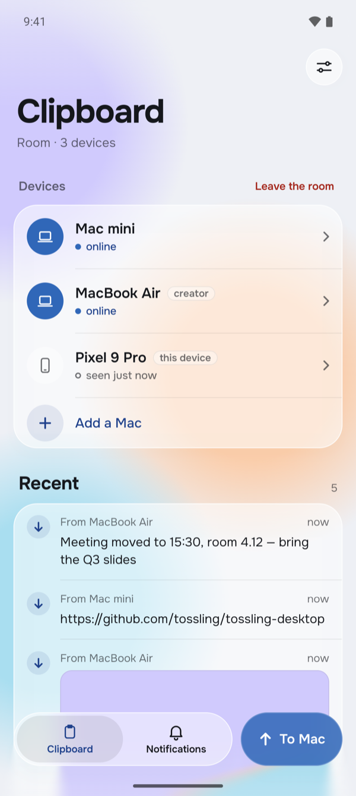

# Tossling

Tossling is one clipboard for your computers and phones. Copy on one device and paste on another a second later.
Text and images go by themselves, files and folders up to 500 MB go when you send them.

Everything goes through your own server. The devices encrypt the content before it leaves them, so the server only
relays ciphertext and never sees the clipboard.

{ width="384" }
{ width="196" }

## How it fits together

- [Tossling Server](server/index.md) is one Docker container on a machine you control. It relays encrypted
  messages between devices and keeps file attachments for three hours.
- The apps run on macOS, Windows, Linux, Android and iOS. See [Install](install.md).
- A room is the group of devices that share a clipboard: a phone and any number of computers. Every room has its own
  encryption key, and every device has its own key pair.
- Projects are channels on your server that services such as CI, monitoring or bots publish to. Every device in the
  room shows their events as notifications. See [Projects](server/projects.md).

## Getting started

1. [Run the server](server/index.md) and open the setup link from its log.
2. [Install the app](install.md) on a computer and connect it to the server with the address and the token from the
   setup page.
3. Scan the QR code the computer shows with the phone app, or add another computer with an invite code.

To see the phone side before setting anything up, install the phone app and tap Try without a computer, or open
[tossling-demo.monoroh.com/demo](https://tossling-demo.monoroh.com/demo). A demo computer shares a room with the phone
for an hour.

## Languages

Menus and messages follow the system language, English or Russian. On a Mac `tossling language en|ru|auto` overrides
it.

## Source code

Tossling is free software under GPL-3.0.

- [tossling-server](https://github.com/tossling/tossling-server): the server
- [tossling-desktop](https://github.com/tossling/tossling-desktop): the apps for macOS, Windows and Linux
- [tossling-mobile](https://github.com/tossling/tossling-mobile): the apps for Android and iOS

This site lives in [Tossling/docs](https://github.com/Tossling/docs). Every page has an edit link at the top.
