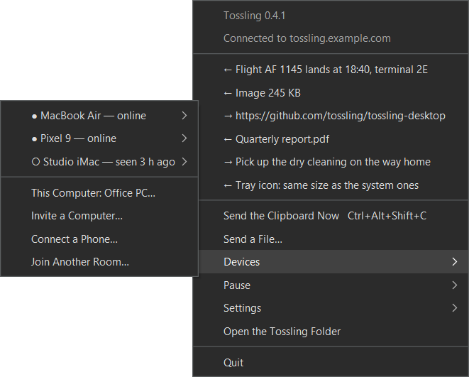
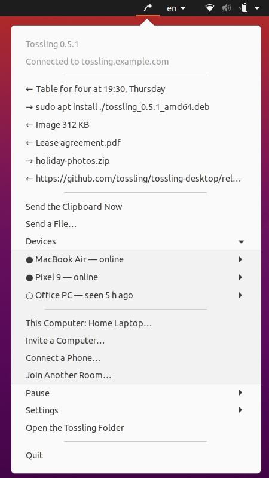

# Install

Tossling needs a [Tossling Server](server/index.md). Set it up first, or ask whoever runs one for an invite.

| Platform | Needs | Get it |
|---|---|---|
| macOS | macOS 13 or newer | [`.dmg` from Releases](https://github.com/tossling/tossling-desktop/releases/latest) or Homebrew |
| Windows | Windows 10 or newer, x64 or ARM | [`.msi` from Releases](https://github.com/tossling/tossling-desktop/releases/latest) |
| Linux | x64 or arm64 | [`.deb` or `.tar.gz` from Releases](https://github.com/tossling/tossling-desktop/releases/latest) |
| Android | Android 13 or newer | [Google Play](https://play.google.com/store/apps/details?id=com.kopylovis.tossling) |
| iPhone and iPad | iOS 17 or newer | [App Store](https://apps.apple.com/app/id6820647520) |

The phone apps pair through a computer: a computer in the room shows a QR code and the phone scans it. Set up a
computer first.

## macOS

Download `Tossling-<version>.dmg` from
[Releases](https://github.com/tossling/tossling-desktop/releases/latest), drag `Tossling.app` to Applications and open
it. Or use Homebrew:

```bash
brew install --cask tossling/tap/tossling
```

The app is signed and notarized. On the first start it asks for the server address and the token, or for an invite
code from another computer, and then shows a QR code for the phone. After that it lives in the menu bar.

macOS may ask you to allow a few things. Tossling works without them, but some features need them:

1. Allow Tossling in Login Items when macOS asks, and allow notifications.
2. For the copy-and-send hotkey, allow Tossling in Accessibility, in the Privacy & Security section of System
   Settings.
3. For "Send via Tossling" in Finder, enable Tossling among the Finder extensions in Login Items & Extensions, in the
   General section of System Settings.

`tossling status` or the menu bar should then say it is connected and list the other devices.

### The `tossling` command

The `tossling` command comes with the app. Homebrew puts it into its `bin`, otherwise the app links it as
`~/.local/bin/tossling`. Add `~/.local/bin` to `PATH` if your shell does not have it. The old name `tossy` still works
as an alias.

### Updates

Updates come through Sparkle. At start and once a day the app looks for a new version and downloads it. Since 0.7.1 it
then installs the update and restarts by itself as soon as no file is being sent or received and its menu and windows
are closed. "Check for Updates…" in the menu asks right away. Updates are signed with Tossling's update key and the same
Developer ID. Builds from source do not update this way.

### Coming from Tossy

Before 0.2 Tossling was called Tossy. If you already run Tossy or a Tossling built from source, just open the app. It
takes over the settings (`~/.config/tossy` moves to `~/.config/tossling`), the room and the history, and removes the
old helper with its Finder extension.

## Windows

{ width="440" }

Download `Tossling-<version>.msi` from [Releases](https://github.com/tossling/tossling-desktop/releases/latest). It
installs for the current user and needs no administrator rights. On Windows 11 for ARM take
`Tossling-<version>-arm64.msi`, which runs natively without x64 emulation.

The installers are not code-signed yet, so Windows asks you to confirm the first start. Choose More info, then Run
anyway.

Tossling sits in the tray. It starts at login (Settings, then Start with Windows) and adds "Send via Tossling" to
Explorer for files and folders. To remove it, uninstall it in Settings, Apps. That removes the app, the autostart and
the Explorer entry. The room and the history stay in `%APPDATA%\Tossling` until you delete them.

## Linux

{ width="199" }

There are two builds on [Releases](https://github.com/tossling/tossling-desktop/releases/latest):

- `tossling_<version>_amd64.deb` (or `_arm64.deb` for ARM) installs into `/opt/tossling` with an entry in the
  applications menu. It runs on Ubuntu 20.04 or newer, Debian, Mint and Pop!_OS.

    ```bash
    sudo apt install ./tossling_<version>_amd64.deb
    ```

- `Tossling-<version>-linux-x64.tar.gz` (or `-linux-arm64.tar.gz`) runs on any distribution without installing.
  Unpack it and start `Tossling/bin/Tossling`.

The icon goes to the panel. KDE, Xfce and Cinnamon show it as is. GNOME needs the AppIndicator extension, which Ubuntu
has built in. If the panel has no place for the icon, Tossling opens a window that explains how to get one.

Tossling adds "Send via Tossling" to Nautilus, Caja, Nemo, Dolphin and Thunar, and starts at login through
`~/.config/autostart/tossling.desktop`.

## Updates on Windows and Linux

Windows and Linux read a feed of new versions signed with the same Ed25519 key as the Mac updates, and install an update
only after its signature checks out. Installed from the `.deb`, Tossling offers new versions in the menu, downloads the
package and installs it through `pkexec`, which asks for your password. The `tar.gz` build only shows a link to the
release.

## Android

Install Tossling from [Google Play](https://play.google.com/store/apps/details?id=com.kopylovis.tossling). It needs
Android 13 or newer.

Open it, tap Pair with a computer and scan the QR code that a computer in the room shows. To look around first, tap
Try without a computer.

## iPhone and iPad

Install Tossling from the [App Store](https://apps.apple.com/app/id6820647520). It needs iOS 17 or newer.

Pair it with a computer by scanning its QR code. Received files go to Files, On My iPhone, Tossling.
