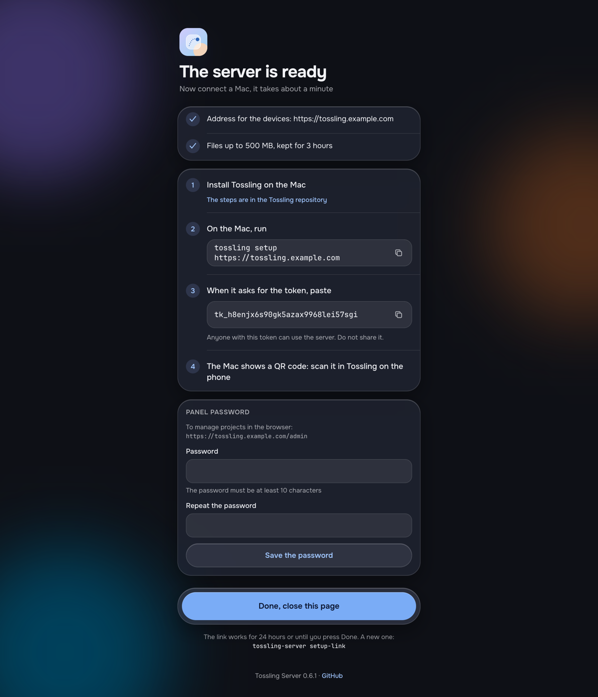

# Run the server

Tossling Server is one Docker container. It relays encrypted messages between the devices of a room and keeps
attachments for three hours. It never sees the clipboard: the devices encrypt everything before sending it.

Inside it is [ntfy](https://github.com/binwiederhier/ntfy), unmodified and embedded as a Go library, with a Tossling
layer in front. That layer sets the server up on the first start, serves the setup page and the web panel, and adds the
access rules Tossling needs. Anything that publishes to ntfy keeps working with it.

You need:

- a Linux machine with Docker and Docker Compose, on `linux/amd64` or `linux/arm64`;
- a domain name for it, for example `tossling.example.com`;
- HTTPS in front of it, usually a reverse proxy. See [Reverse proxy](reverse-proxy.md).

## Start it with Docker Compose

Save this as `docker-compose.yml`. Set `TOSSLING_BASE_URL` to the address the devices will use.

```yaml
services:
  tossling-server:
    image: ghcr.io/tossling/tossling-server:latest
    restart: unless-stopped
    ports:
      - "8090:8090"
    environment:
      TOSSLING_BASE_URL: https://tossling.example.com
      TOSSLING_BEHIND_PROXY: "true"
    volumes:
      - ./data:/data
```

`TOSSLING_BEHIND_PROXY` is for a server behind a reverse proxy, which is the usual case. Leave it out only if clients
connect to the container directly.

Start it and read the log:

```bash
docker compose up -d
docker compose logs tossling-server
```

Data lives in `./data`. The server runs as user 10001 and makes `./data` its own when it starts. To run it as another
user, set `TOSSLING_RUN_AS` (see [Configuration](configuration.md)).

To build the image yourself instead, clone [tossling-server](https://github.com/tossling/tossling-server) and run
`docker build -t tossling-server .`.

## The setup link

On the first start the server creates the device user, its access rules and a token, and prints a link to the setup
page:

```text
Finish the setup on this page (it works for 24 hours):

    https://tossling.example.com/setup/…
```

The setup page checks that the address works, shows the server token and the command for a Mac, and lets you set the
password of the [web panel](web-panel.md). The link stops working once you press Done there, or after 24 hours.

{ width="420" }

If the link has expired or you lost it, ask for a new one:

```bash
docker compose exec tossling-server tossling-server setup-link
```

Security in the web panel also issues a new setup link.

## Connect the first computer

[Install the app](../install.md) on a computer. In the first-run window choose Connect my server and enter the
address and the token from the setup page. The app creates a room and shows a QR code for the phone.

The token from the setup page is the room token. It goes into QR codes and invites. On Tossling Server 0.5 and later
(except demo servers) every device then gets a token of its own from the server and talks to it with that one.

## Next

- [Reverse proxy](reverse-proxy.md): HTTPS, large files and streaming.
- [Configuration](configuration.md): every flag and variable.
- [Projects](projects.md): notifications from your services.
- [Instant delivery](instant-delivery.md): waking phones through Firebase.
