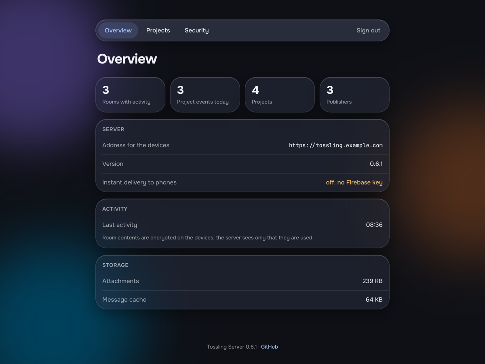
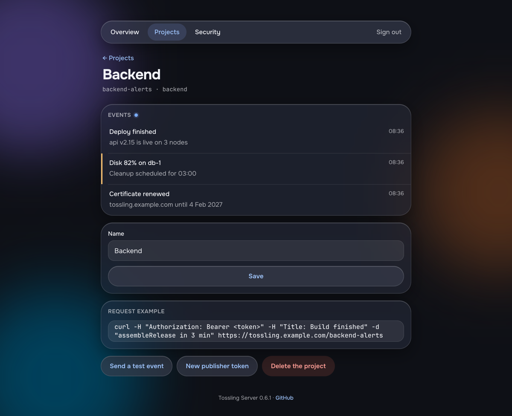

# Web panel

`https://tossling.example.com/admin` manages the server in the browser.

{ width="600" }

## Signing in

Set the password on the [setup page](index.md#the-setup-link), or on the server:

```bash
docker compose exec tossling-server tossling-server admin-password
```

The password needs at least 10 characters. Setting a new one signs out every session. Sessions last 30 days, and
sign-in attempts are limited per address.

## Pages

Overview
:   Rooms in use, project events, storage and whether Firebase is set up.

Projects
:   Your [projects](projects.md) with their recent events. Here you create a project, rename it, send a test event,
    issue a new publisher token or delete the project. The page with a new publisher token also gives webhook
    addresses for GitHub, Grafana and Alertmanager.

Security
:   Room tokens and publishers with the time their tokens were last used, a new setup link, the panel password, and
    signing out everywhere.

{ width="600" }

## Room tokens

The server keeps at most 60 tokens for devices. When the limit is reached, it refuses to issue more with 409 instead
of dropping an old token that a live room may still use. Remove the room tokens nobody uses any more on the Security
page. The last-used time shows which ones those are.

The server's own token from the setup page cannot be removed.
